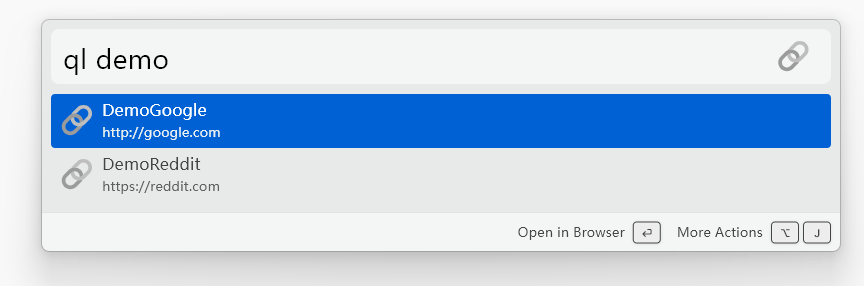

# Quick Links

A [Wox](https://github.com/Wox-launcher/Wox) plugin to save and quickly open named URLs in your browser.



## Install

```
wpm install quicklinks
```

## Usage

| Query                        | Action                      |
| ---------------------------- | --------------------------- |
| `ql`                         | List all saved links        |
| `ql <search>`                | Filter links by name or URL |
| `ql add <name> <url>`        | Save a new link             |
| `ql <name> <arg1> <arg2>...` | Fill placeholders and open  |

Hit enter to open selected link.

Links can also be managed directly in the Wox settings UI under the Quick Links plugin.

## Pinyin search

In **Wox Settings → Plugins → Quick Links**, use **Pinyin search** (**拼音检索** in Chinese) to control this feature.
It is **enabled by default**, independent of Wox's global pinyin setting, and changes take effect immediately.
The label and tooltip follow Wox's display language: Chinese locales use Simplified Chinese, and other languages fall back to English.

For a link named `雷神加速器`:

| Query                 | Matching mode                    |
| --------------------- | -------------------------------- |
| `ql leishen`          | Full pinyin for part of the name |
| `ql leishenjiasuqi`   | Full pinyin for the entire name  |
| `ql ls` or `ql lsjsq` | Pinyin initials                  |
| `ql leis`             | Syllable prefixes                |
| `ql 雷shen`           | Mixed Chinese and pinyin         |

Matching is case-insensitive, supports polyphonic characters and `v` for `ü`, and requires consecutive characters in the link name.
The original name/URL substring matching and result ordering are preserved, including when pinyin search is disabled.
Pinyin matching runs locally using the bundled [pinyin-pro](https://github.com/zh-lx/pinyin-pro) library.

Use your configured trigger in place of `ql`. For placeholder links, select the link using pinyin and then use **Fill & Open** to enter arguments after its original name.

## Placeholders

URLs can contain `{}` placeholders that are filled in at open time.

```
ql add gs https://www.google.com/search?q={}
```

When you select a link with placeholders, Quick Links switches to fill mode — type the link name followed by your arguments:

```
ql gs some search query
```

The last placeholder absorbs all remaining words. Multiple placeholders are filled positionally, with the final one capturing the rest of the input.

```
ql add gh https://github.com/{}/{}
ql gh myorg myrepo
# opens https://github.com/myorg/myrepo
```

Selecting a placeholder link from the list shows a **Fill & Open** action (pre-fills the query so you can type arguments) and an **Open as-is** action (opens the URL with the `{}` tokens unfilled).

## Development

Use Node.js 20 or later and pnpm. Install the locked dependencies and run the checks:

```sh
pnpm install --frozen-lockfile
pnpm test -- --runInBand
pnpm exec tsc --noEmit
pnpm lint
```

Builds must include the bundled dependency licenses. The release workflow generates `licenses.txt` using ncc and includes it in the `.wox` package.
